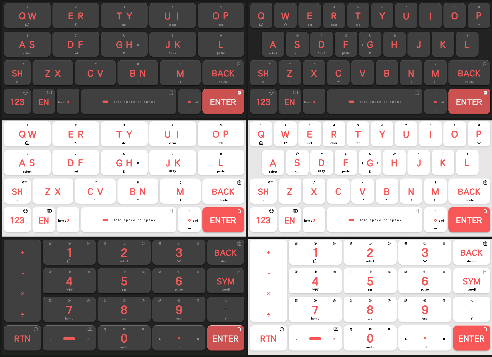
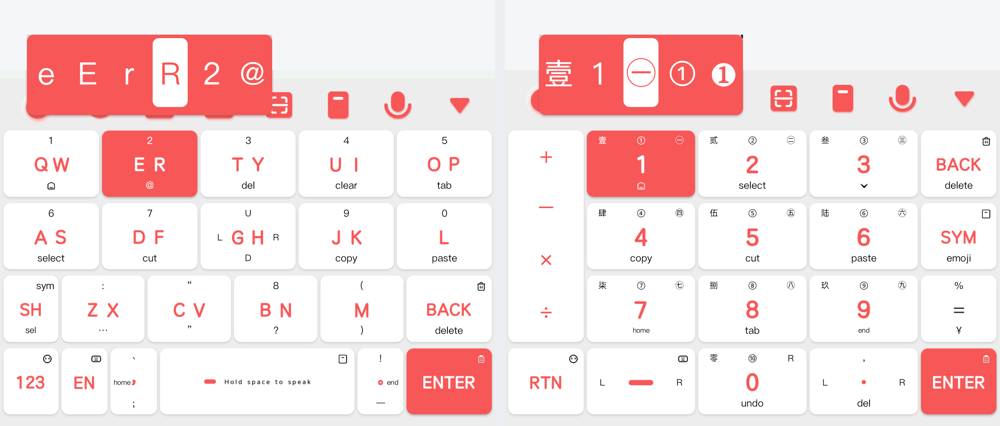
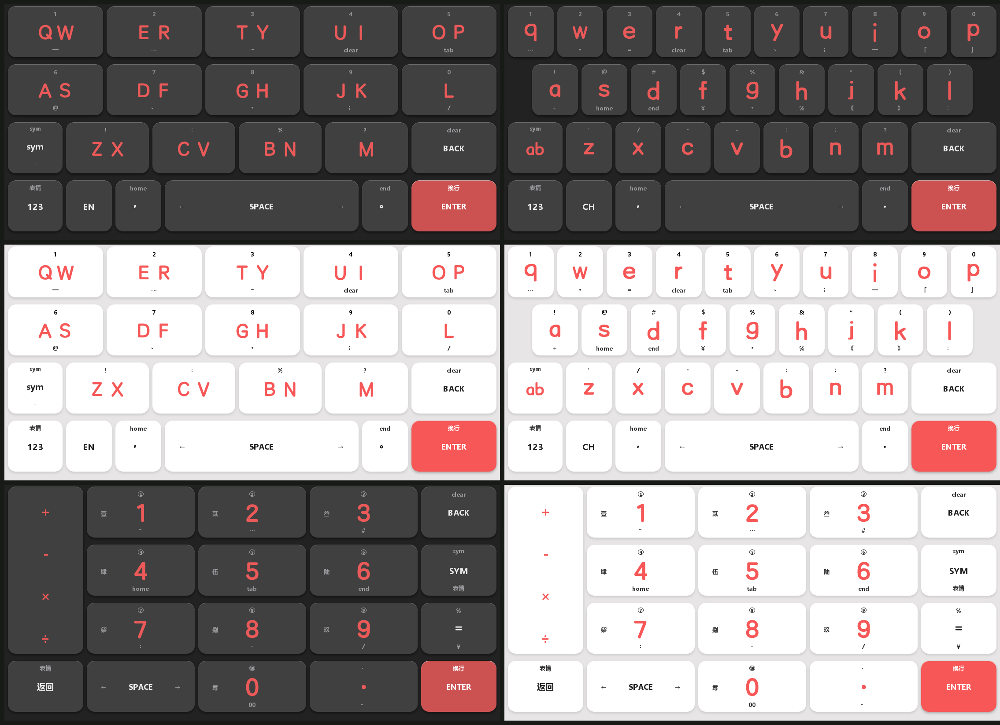
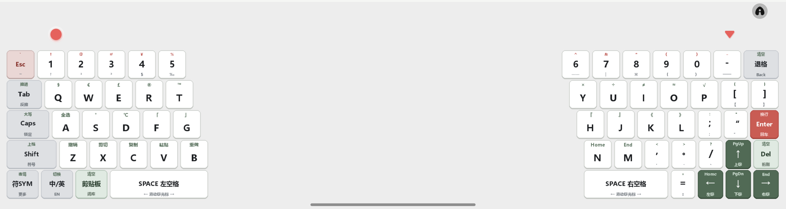
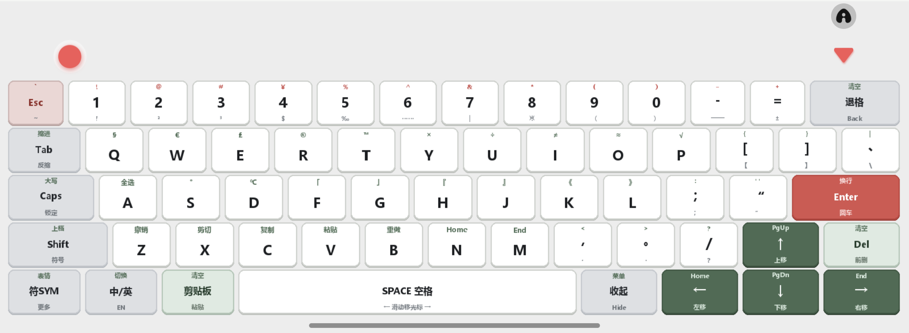

# 森林集魔改 (Forest IME Mod)

基于「Write-森林集」视觉风格深度定制的输入法皮肤与平板分体键盘套件，包含 **Android 手机版 (`android/`)**、**iOS 手机版 (`ios/`)** 与 **Android 平板版 (`android-pad/`)** 三个版本，全系支持深浅色双模自动切换与高精度 9-Slice 1:1 键帽贴图。

---

## 目录结构与版本概览

| 版本目录 | 适用平台 | 交付产物 | 核心特性 |
| :--- | :--- | :--- | :--- |
| [`android/`](./android/) | Android 手机端（百度输入法） | [`森林集-全能Pro.bds`](./android/森林集-全能Pro.bds) | 14键 / 26键 / 数字九宫格全布局；全选/剪切/复制/粘贴/撤销/重做/行首/行尾/退格滑删手势；长按气泡多选符号；GH/G 键四向光标导航 |
| [`ios/`](./ios/) | iOS 手机端（百度输入法） | [`Write-森林集.bdi`](./ios/Write-森林集.bdi) | 14键 / 26键 / 数字九宫格全布局；针对 iOS 引擎深度适配的上下滑符号与光标移动；原生 AIFF 按键音效；键帽显示与实际触发 100% 对应 |
| [`android-pad/`](./android-pad/) | Android 平板端（百度输入法皮肤 + 独立输入法 APK） | [`Write-森林集-Pad.bds`](./android-pad/Write-森林集-Pad.bds) [`ForestPadIME.apk`](./android-pad/ForestPadIME.apk) | 横屏 65% 窄距分体机械配列（单侧拇指区 ≤65mm + 中央留空）+ 竖屏 65% 标准阶梯全配列（62键 + 倒T方向键）；独立 APK 支持横屏中央真透明触控穿透、自由拖拽悬浮、实体键盘自动隐藏与 12.4 万词本地词库 |

---

## 一、Android 手机版 (`android/`)

- **皮肤文件**：[`android/森林集-全能Pro.bds`](./android/森林集-全能Pro.bds)
- **构建与校验脚本**：[`android/build_android_skin.py`](./android/build_android_skin.py)、[`android/verify_bds.py`](./android/verify_bds.py)

### 界面预览（深色 / 浅色双模 · 14键 / 26键 / 数字九宫格）

### 长按气泡选符实机效果

### 核心手势与布局特性

1. **14 键与 26 键快捷编辑**：
   - **第一排下滑**：`QW/Q` 菜单、`ER/W` `@`、`TY/E` 前删 (`del`)、`UI/R` 清空 (`clear`)、`OP/T` 缩进 (`tab`)、`P` 收起键盘。
   - **第二排下滑**：`AS/A` 全选 (`select`)、`DF/S` 剪切 (`cut`)、`JK/D` 复制 (`copy`)、`L/F` 粘贴 (`paste`)。
   - **四向光标导航**：14 键 `GH` 键与 26 键 `G` 键支持上下左右四向滑动移动光标。
   - **退格与回车**：`BACK` 上滑清空重输、左右滑连续滑删；`ENTER` 上滑呼出剪贴板面板；`EN` 上滑切换 14 键 / 26 键或输入法；`，` 左滑行首 (`home`)、`。` 右滑行尾 (`end`)。
2. **长按气泡多选**：
   - 字母键与标点键长按弹出高清多符号候选气泡，滑动即可直接上屏对应数字、大小写字母或成对标点。
3. **数字九宫格多维输入**：
   - `1~9` / `0`：点按输入数字，上滑输入 `①~⑩`，左滑输入中文大写数字 `壹~玖/零`，右滑输入带圈中文数字 `㊀~㊈`，长按展示全部序号候选；`0` 下滑撤销 (`undo`)，`.` 下滑前删 (`del`)。

---

## 二、iOS 手机版 (`ios/`)

- **皮肤文件**：[`ios/Write-森林集.bdi`](./ios/Write-森林集.bdi)
- **构建与校验脚本**：[`ios/build_ios_skin.py`](./ios/build_ios_skin.py)、[`ios/verify_bdi.py`](./ios/verify_bdi.py)

### 界面预览（深色 / 浅色双模 · 14键中文 / 26键英文 / 数字九宫格）

### 核心手势与布局特性

1. **专为 iOS 百度输入法引擎深度定制**：
   - 剔除所有在 iOS 端无法响应的安卓专属功能码，键帽上的每一处副标文字与实际触发行为 100% 一致。
   - 内置原生 AIFF 低延迟按键音效（普通按键 `aj.aiff` / 功能键 `b.aiff`），支持系统深色/浅色模式自动切换。
2. **14 键布局（`py_9.ini` / `py_14.ini`）**：
   - **第一排（`QW` ~ `OP`）**：上滑 `1~5`，下滑 `—`、`…`、`~`、`clear`（清空）、`tab`。
   - **第二排（`AS` ~ `L`）**：上滑 `6~0`，下滑 `@`、`、`、`·`（`GH` 键同时支持左滑 `g` / 右滑 `h`）、`；`、`/`。
   - **第三排（`sym` + `ZX` ~ `M` + `BACK`）**：`sym` 点按与上滑均打开符号面板（五分类完整符号库 + 底部翻页/返回/退格栏），下滑输入分词符 `'`；`ZX` / `CV` / `BN` / `M` 上滑分别输入 `！`、`：`、`%`、`？`；`BACK` 上滑 `clear` 清空。
   - **第四排**：`123` 上滑表情；`EN` 纯净切换中英文；`，` 上滑移至行首 (`home`)；`SPACE` 左右滑移动光标（`←` / `→`）；`。` 上滑移至行尾 (`end`)；`ENTER` 上滑软换行（直接换行不发送消息）。
3. **26 键布局（`py_26.ini` / `en_26.ini`）**：
   - **第一排（`Q` ~ `P`）**：上滑 `1~0`，下滑 `…`、`·`、`=`、`clear`、`tab`、`、`、`；`、`—`、`「`、`」`。
   - **第二排（`A` ~ `L`）**：上滑 `!`、`@`、`#`、`$`、`%`、`&`、`*`、`(`、`)`，下滑 `+`、`home`、`end`、`¥`、`·`、`%`、`《`、`》`、`：`（中英文及大写锁定状态下均完整保留）。
   - **第三排（`Z` ~ `M`）**：上滑 `'`、`/`、`-`、`_`、`:`、`;`、`?`。

---

## 三、Android 平板版 (`android-pad/`)

- **百度输入法平板皮肤**：[`android-pad/Write-森林集-Pad.bds`](./android-pad/Write-森林集-Pad.bds)
- **独立平板输入法应用**：[`android-pad/ForestPadIME.apk`](./android-pad/ForestPadIME.apk)
- **构建脚本**：[`android-pad/build_pad_bds.py`](./android-pad/build_pad_bds.py)、[`android-pad/build_pad_ime_apk.py`](./android-pad/build_pad_ime_apk.py)、[`android-pad/compile_dict.py`](./android-pad/compile_dict.py)

### 横屏 65% 窄距分体机械配列实机效果

### 竖屏 65% 标准阶梯全配列实机效果

### 核心特性

1. **横屏 65% 窄距分体 + 竖屏 65% 标准阶梯全配列**：
   - 横屏左半区宽 26.4%（约 65mm）、右半区宽 27.7%（约 68mm）、中央留空 45.9%，双手握持平板时拇指无需拉伸即可轻松覆盖 `5/T/G/B` 与 `6/Y/H/N`。
   - 完整配备独立数字行 `1~0`、`Esc`、`Tab`、`Caps`、`Shift`、`-`、`=`、`[`、`]`、`\`、`;`、`'`、`,`、`.`、`/`、`Del` 及右下角倒 T 方向键（`↑` `↓` `←` `→`，上滑对应 `PgUp` / `PgDn` / `Home` / `End`）。
2. **`ForestPadIME.apk` 独立输入法专属增强**：
   - **内置 12.4 万词 + 8,105 字本地词库**：支持整句拼音连打与前缀分词递进选词（选定前半句词组后自动保留剩余未消费拼音继续组词），长按退格一键清空未上屏拼音串。
   - **中央留空区真透明与触控穿透**：分体模式下中央留空区域完全透明，底层应用可正常滚动与点击；支持 `✥ 移动` 手柄自由拖拽键盘位置，横竖屏分体/全宽状态独立记忆。
   - **内侧边界防误触「幽灵键」**：在左半区 `5/T/G/B` 右侧边缘外点按自动触发 `6/Y/H/N`，在右半区 `6/Y/H/N` 左侧边缘外点按自动触发 `5/T/G/B`。
   - **实体键盘无缝协同**：检测到外接实体键盘按键时自动收起屏幕软键盘，仅保留角落轻量恢复胶囊按鈕。

---

## 安装方法

1. **Android 手机版 / 平板皮肤版 (`.bds`)**：
   - 将 [`森林集-全能Pro.bds`](./android/森林集-全能Pro.bds) 或 [`Write-森林集-Pad.bds`](./android-pad/Write-森林集-Pad.bds) 发送至设备，使用百度输入法打开即可直接导入并启用；或放入 `/sdcard/baidu/ime/skins/` 目录后在百度输入法「超级皮肤 → 本地」中启用。
2. **iOS 手机版 (`.bdi`)**：
   - 将 [`Write-森林集.bdi`](./ios/Write-森林集.bdi) 保存至 iPhone「文件」App 或通过隔空投送（AirDrop）发送至 iPhone，点击文件并选择「使用百度输入法打开」即可一键安装启用。
3. **Android 平板独立输入法 (`ForestPadIME.apk`)**：
   - 安装 [`ForestPadIME.apk`](./android-pad/ForestPadIME.apk) 后，进入系统「设置 → 语言与输入法」启用「森林集Pad分体机械键盘」并切换为当前输入法。
